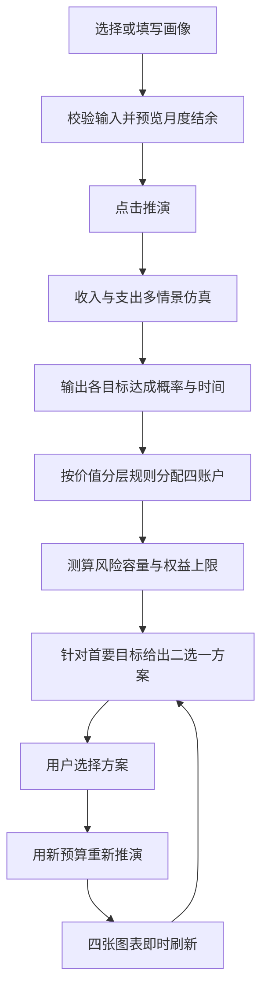
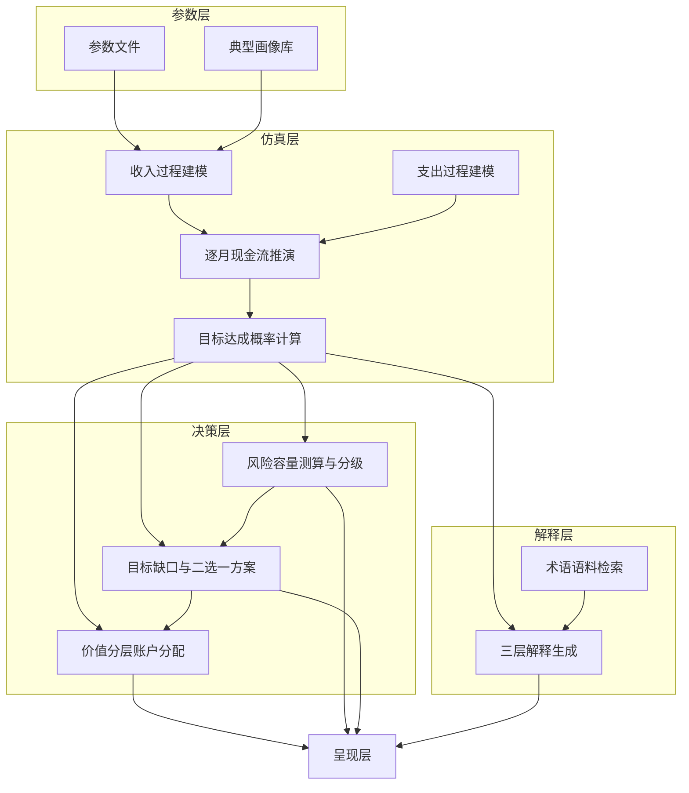
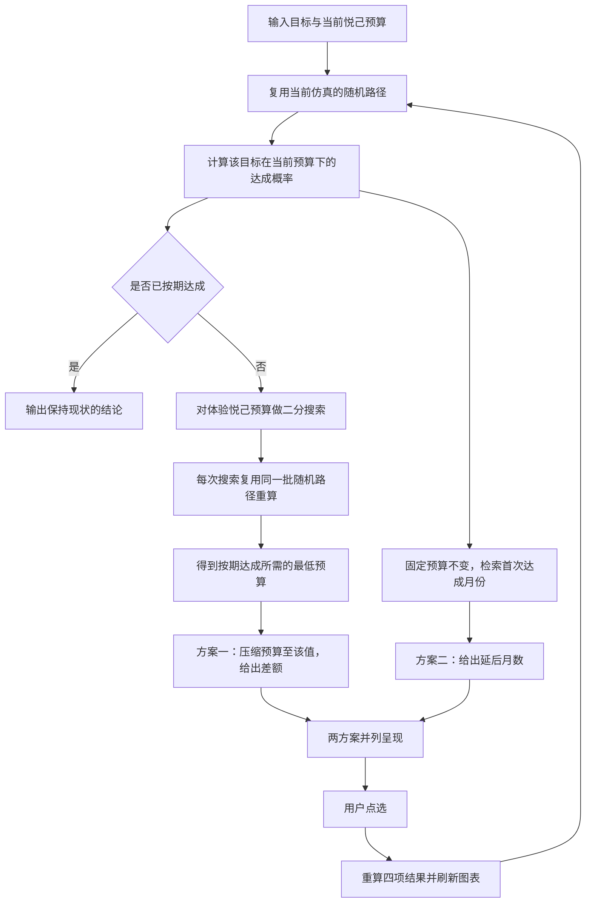

# 需求收集与需求补全

> 本文补足原需求规格说明书缺失的三项内容：需求收集过程、用户故事、业务流程图。
> 原文档的 FR 编号、AC 编号、GR 编号沿用不变。

## 一、需求收集

本项目没有外部委托客户，需求不是从访谈中得来，而是从三个方向推导：交付方向的产品定位约束、目标用户群体的公开调研数据、现有同类工具的能力缺口。这一节把推导链条固定下来，以便评审时能够追溯每一条需求为何存在。

### （一）利益相关者

| 角色 | 关注点 | 对需求的影响 |
| --- | --- | --- |
| 交付方 | 产品定位与目标用户群的匹配度，合规底线，创新性 | 划定五条产品边界（2.3 节），决定合规需求 CP-01 至 CP-05 |
| 主要用户　在校大学生 | 能不能看懂，会不会被说教，填起来麻不麻烦 | 决定默认画像、三分钟主链路、术语三层解释 |
| 次要用户　职场新人 | 在留够刚需之后还剩多少钱可以长期投入 | 决定安全底座优先的分配规则 GR-01 |
| 演示受众　现场观众 | 几分钟内能否看懂产品与现有工具的差别 | 决定沙盘 Tab 的结论层与四张图的排布 |
| 开发团队 | 工期、可维护性、是否有降级方案 | 决定模块优先级划分与 8.4 节的项目约束 |

### （二）业务目标

1. 交付目标。提交一个可本地运行、可现场演示、链路完整的产品原型。
2. 产品目标。让收入不确定的人群看见自己消费的机会成本，而不是被劝告少花钱。
3. 叙事目标。说清"为什么面向大众的记账与理财工具不适用于这个群体"，这是与同类作品拉开差距的关键。

### （三）需求的来源与获取方式

| 需求类别 | 来源 | 获取方式 | 对应章节 |
| --- | --- | --- | --- |
| 用户痛点 P1 至 P7 | 公开调研数据的二次分析 | 交叉比对多份公开报告，归纳出结构性缺口 | 附录 D |
| 功能需求 FR-01 至 FR-25 | 由痛点逐条推导 | 每条痛点映射到一至三条功能需求 | 第四章 |
| 参数需求 | 公开调研报告与行业惯例 | 摘取报告中的汇总数值，非原始微数据 | 附录 A、附录 B |
| 合规需求 CP-01 至 CP-05 | 《理财公司理财产品销售管理暂行办法》 | 摘录适当性管理与风险揭示的相关条款要求 | 7.6 节 |
| 界面需求 | 产品定位与演示场景 | 按"三分钟讲完"倒推界面信息层级 | 第五章 |
| 非功能需求 | 本地运行与演示环境 | 由部署形态反推性能、兼容性与可靠性指标 | 第七章 |

### （四）需求收集环节存在的空白

评审认为以下三项在原文档中缺失，补记于此，供后续版本补入正文：

1. **未声明一手调研的缺位。** 产品面向大学生群体，却没有访谈、问卷或可用性测试记录。当前做法是用公开调研数据替代一手调研，这一替代关系必须在文档中明确写出，否则会被质疑"你凭什么认为用户是这么想的"。
2. **未记录竞品分析。** 2.3 节断言"现有工具隐含三个不成立的前提"，但只给了结论，没有给出具体产品作为对照。建议补一份简短竞品分析，至少覆盖记账类与理财类各一至两款，说明它们在收入不确定场景下的失效点。
3. **未记录需求优先级的排序依据。** 模块优先级直接标为"核心／重要／可选"，但没有说明排序标准。建议补一条：以"缺失后产品是否还能成立"为唯一标准，核心定义为缺失即不成立。

## 二、用户故事

用户故事按角色分组，每条的验收条件回指原文档的功能需求编号与验收项编号。凡原文档已覆盖的功能，此处不重复定义，只补充用户视角的表达与验收口径。

### （一）在校大学生（主要用户）

| 编号 | 用户故事 | 验收条件 |
| --- | --- | --- |
| US-01 | 作为在校大学生，我希望在不填任何内容的情况下先看到一次完整推演，以便先弄明白这个工具到底在做什么。 | AC-01 |
| US-02 | 作为在校大学生，我希望分别配置生活费、兼职、奖学金、实习四类收入，并说明它们各自有多不确定，以便系统按我的真实收入结构推演，而不是按一个固定月薪。 | FR-02、FR-06 |
| US-03 | 作为在校大学生，我希望同时设置考研、考证、旅行等多个目标并排出优先级，以便知道哪些能按时达成、哪些会被往后挤。 | FR-03、FR-09 |
| US-04 | 作为在校大学生，我希望把"能提升自己"和"纯粹开心"的花费分开设上限，以便系统不要用同一把尺子砍掉我所有的开销。 | FR-04、FR-11、FR-12 |
| US-05 | 作为在校大学生，我希望看到"按现在这种花法，我的目标会推迟几个月"这样一句直接的话，以便真正理解这笔钱花掉之后发生了什么。 | FR-09、FR-18 |
| US-06 | 作为在校大学生，我希望系统先告诉我客观上能承受多大波动，而不是先问我"你能接受亏多少"。 | FR-14、FR-15 |
| US-07 | 作为在校大学生，我希望看到未来两年里哪几个月我最脆弱，以便提前留出余地。 | FR-16 |
| US-08 | 作为在校大学生，我希望术语解释的最后一部分讲的是"这个波动对我那个目标意味着什么"，而不是把产品说明书抄一遍。 | FR-21 |

### （二）职场新人（次要用户）

| 编号 | 用户故事 | 验收条件 |
| --- | --- | --- |
| US-09 | 作为职场新人，我希望知道在留够租房与进修的刚需之后，还能拿出多少钱做长期投入，以便投入不影响近期开支。 | FR-11、FR-12、GR-01 |
| US-10 | 作为职场新人，我希望系统给出两个互斥的方案并算清各自的代价，以便我自己做取舍，而不是被给一个建议。 | FR-17、FR-18 |
| US-11 | 作为职场新人，我希望换一个方案之后结果立刻刷新，以便连续比较几种可能。 | FR-19、UI-01 |

### （三）演示受众

| 编号 | 用户故事 | 验收条件 |
| --- | --- | --- |
| US-12 | 作为观众，我希望在三分钟内看完从输入到结论的完整链路，以便判断这个产品究竟解决了什么问题。 | 9.2 节演示验收 |
| US-13 | 作为观众，我希望看到同一目标在两种花法下的具体差异，而不是一堆抽象曲线。 | AC-05、AC-06 |

### （四）用户故事与原需求的对应关系

原文档自 FR-01 至 FR-25 逐条描述"系统做什么"，本节从"用户要什么"反向补齐，两者互为印证。原文档的一处结构性缺失在此暴露：**FR 全部以系统功能为单位切分，没有一条以用户完成任务为单位**。例如"设置目标—被告知会延后—调整预算—再看到新结果"是一条完整的用户任务，却横跨 M1、M2、M5 三个模块。建议在下一版中增设"用户任务"维度的编号（UT-01 起），与 FR 形成矩阵，便于检查每个模块是否真的服务于一条完整任务。

## 三、业务流程

### （一）主流程

主流程共八步，是三分钟演示的动线，与 3.4 节一致。

### （二）仿真与决策的内部流程

图中可见一处跨层调用：**D3 与 D2 均需要回读仿真层结果，且 D3 在生成方案时需要反复触发 S3**。原文档 3.2 节规定"每层职责单一，不允许跨层调用"，此处需要补一条例外说明，否则实现阶段必然与文档冲突。处理方式见架构设计文档。

### （三）二选一方案的生成流程

这是全产品唯一需要反向求解的流程，也是实现风险最高的一环。

流程中标注"复用同一批随机路径"是关键约束。若每次搜索重新抽样，同一份输入会得到波动的输出，既违反 NF-03 的可复现要求，也会让现场演示的结果不可复述。

## 四、本次补全与原文档的差异清单

| 序号 | 补全内容 | 原文档状态 | 处理 |
| --- | --- | --- | --- |
| 1 | 需求收集过程与来源推导 | 完全缺失 | 本文第一节 |
| 2 | 利益相关者与关注点 | 仅列目标用户 | 本文第一节 |
| 3 | 一手调研缺位的声明 | 完全缺失 | 本文第一节（四） |
| 4 | 竞品分析 | 仅有结论无证据 | 列入待补事项 |
| 5 | 用户故事 | 完全缺失 | 本文第二节 |
| 6 | 用户任务维度编号 | 完全缺失 | 本文第二节（四）建议增设 |
| 7 | 业务流程图 | 仅有文字描述 | 本文第三节 |
| 8 | 二选一方案的内部流程 | 仅有结果描述 | 本文第三节（三） |
| 9 | 跨层调用的例外说明 | 与 3.2 节规定冲突 | 见架构设计文档 |
